# TestPilot AI: High-Level Design

**Audience:** Python Mirai Squad (internal)
**Code revision:** `208eec6` on `main`; every diagram cites source lines at this revision
**Companion:** [LLD.md](LLD.md), the module and function level design

---

## 1. Purpose

Writing API tests is part of every engineer's day, and it is slow. Postman scripts and pytest files are written by hand, one endpoint at a time. Schema checks are easy to write, so they get written, while the business rules ("email must be unique", "a user may only edit themselves") often go untested until a bug reaches staging. AI chat tools such as Claude and ChatGPT can draft tests, but that is manual prompting and copy-paste, with no flow, no record and no reliable pass or fail.

TestPilot AI turns an OpenAPI spec plus your business rules into a reviewed, runnable test plan, runs it against a test server, and reports what to fix.

### Goals

- Plan API tests from a spec and plain-English rules in a few minutes, not hours.
- Keep pass or fail deterministic: code judges every response, never the AI.
- Test protected APIs without manual token work: sign in by itself, with one or two users.
- Explain every failure and suggest a fix the developer can act on.
- Work with whichever AI provider a team has: Anthropic API, OpenAI, or any model on AWS Bedrock.

### Non-goals

- Load or performance testing (only a per-request time check).
- Testing production systems: requests go only to hosts on an allowlist.
- Replacing a team's committed test suite (exporting tests as code is on the roadmap).

## 2. Design principles

| Principle | What it means in the code |
|---|---|
| AI plans and explains; code runs and judges | The planner and the failure analyst call the AI. The runner sends requests and `validator.validate` decides pass or fail from status codes, the documented schema and time limits. |
| Every AI answer is validated | AI output is parsed into Pydantic models; each AI test case is checked against the spec before it can run (`engines/ai_planner.to_test_case`). |
| Secrets never travel | Tokens and passwords live as secret environment variables, are filled in only at send time, and are replaced by `••••` in every stored exchange and report. |
| Safe by default | Only allowlisted hosts, a request budget per run, destructive requests off unless chosen, and setup steps can never send DELETE. |
| One flow for the common case | Four steps (Your API, What to test, Review plan, Results); the Postman-style workspace stays available for everything else. |

## 3. The user flow

<picture>
  <source media="(prefers-color-scheme: dark)" srcset="diagrams/four-step-flow-dark.svg">
  
</picture>

1. **Your API.** Paste the OpenAPI spec link (or text) and the server to test. TestPilot reads the spec, finds or creates a project and environment, and works out how the API authenticates.
2. **What to test.** A numbered form: endpoints, the goal, objectives, depth, business rules, case sources, then optional auth and roles, test data and exclusions. "Build the plan" starts planning in the background.
3. **Review plan.** Every case shows who made it (AI, Schema, Fuzzing or Written by you) and why. Edit, delete, add or ask the AI to refine before anything runs.
4. **Results.** A "What to fix" table, one row per root cause, opened in place with Request, Response, Checks and Fix tabs.

## 4. Architecture

<picture>
  <source media="(prefers-color-scheme: dark)" srcset="diagrams/architecture-dark.svg">
  
</picture>

| Component | Responsibility | Main code |
|---|---|---|
| Web app | The four-step flow, test plans list, report, Postman-style workspace, settings | `frontend/app/` (Next.js 15, React 19) |
| API server | REST routes under `/api`; starts planning and runs as background tasks | `backend/main.py`, `backend/api/*` |
| Planner | Schema cases, AI strategy, AI cases per endpoint, review pass, dedupe | `backend/planner.py`, `backend/engines/` |
| Runner | Sign-in (one or two users), sends each case, validates, fuzzes, asks the AI to explain failures | `backend/runner.py`, `backend/executor.py`, `backend/validator.py` |
| AI gateway | One structured call for any provider; turns provider errors into plain messages | `backend/ai_auth.py`, prompts in `backend/ai.py` |
| SQLite | Workspace tables plus JSON documents for specs, plans and runs | `backend/db.py`, `backend/store.py`, `backend/workspace_repo.py` |
| API under test | Any HTTP API on an allowlisted host | `backend/spec_parser.ensure_allowed_url` |

The frontend calls `/api/*`; Next.js rewrites those calls to the backend (`TESTPILOT_BACKEND_URL`, default `http://127.0.0.1:8001`). Planning and runs are `asyncio` tasks started with `state.spawn`; the browser polls the plan or run until it is done.

## 5. Key flows

Sequence diagrams for these flows are in the LLD.

**Building a plan.** `POST /api/test-plans/start` parses the spec, detects the auth style and saves the spec, project and environment. `POST /api/test-plans` saves the settings as a suite and starts `run_planning`: schema cases first (no AI), then an AI strategy, then one AI call per endpoint (three at a time), each case validated against the spec, then an AI review pass, then dedupe. The plan is saved as `ready`.

**Running a plan.** `POST /api/plans/{id}/runs` starts `execute_run`. The runner signs in when the plan needs it, sends every case (setup steps first), and the validator judges each response. Optional fuzzing with Schemathesis runs after the planned cases. Failures go to the AI in batches of 12 for a title, severity, likely cause and a shared cause label used to group repeats.

**Fix on request.** `POST /api/runs/{id}/cases/{case}/fix` asks the AI where the fault is (API, test or spec), with steps, a code sketch and how to confirm. The answer is stored on the run, so asking again is free.

## 6. Authentication of the API under test

TestPilot reads the spec's security schemes and endpoints (`auth_detect.detect`) and picks one of four modes:

| What the spec has | Mode | What happens |
|---|---|---|
| No protected endpoint | `none` | Nothing is asked |
| Sign-up and sign-in endpoints | `auto` | Each run registers a fresh test user, signs in and uses the token |
| Sign-in only | `credentials` | Step 1 asks once for a test login, stored as secrets |
| Protected, no sign-in endpoint | `token` | Step 1 asks for a token or API key |

With **Test with a second user** on, each run also signs in user B (a second fresh user, or a second saved login) and the AI writes cases where user B tries to read, change or delete user A's data, expecting 403 or 404. Sign-in happens once per run; the tokens fill `{{token}}` and `{{token_b}}`.

## 7. AI providers

`ai_auth.call_structured(system, user, OutputModel)` is the only entry point. It returns a validated Pydantic object whichever provider is set in Settings:

| Provider | Route |
|---|---|
| Anthropic API | Messages API with structured output and server-side fallbacks |
| OpenAI | Responses API with structured output |
| AWS Bedrock, Anthropic models | Anthropic SDK for Bedrock (Mantle or runtime route, chosen by model id) |
| AWS Bedrock, other models (gpt-oss, Llama, Nova, Mistral) | Converse API with a forced tool call, stepping down to plain JSON when a model lacks tool support |

Provider settings and keys are saved from the Settings page into `data/settings.json` (owner-only file permissions) and are never sent back to the browser. The UI names no model; it says "AI".

## 8. Data

One SQLite file, `data/testpilot.db` (gitignored):

- **Workspace tables:** `projects`, `environments`, `collections`, `folders`, `items`. A test plan in the guided flow is a suite item in the project's "Test plans" collection.
- **Documents:** the `objects` table holds specs, raw specs, plans and runs as JSON, keyed by kind and id.

The ERD is in the LLD.

## 9. Security and safety

- Requests go only to hosts on the allowlist (Settings; default `localhost`, `127.0.0.1`).
- Each run has a request budget (default 300) and a per-request timeout (default 10 s).
- Destructive requests (DELETE) are skipped unless the run allows them; setup steps may never DELETE.
- Secret environment values, sign-in tokens and passwords are redacted from every stored exchange, report and AI prompt.
- AI output is data: it is validated and can only produce test cases or text; it never executes code.
- API keys are stored with owner-only permissions; the settings API returns only masked hints.

## 10. Running it

| Piece | Command | Port |
|---|---|---|
| All three | `./scripts/dev.sh` | 8008, 8001, 3000 |
| Backend | `.venv/bin/uvicorn backend.main:app --port 8001` | 8001 |
| Frontend | `cd frontend && npm run dev` | 3000 |
| Demo APIs | `.venv/bin/uvicorn demo_api.main:app --port 8008` | 8008 |
| Team server | `docker compose up -d --build` | 3000 |

Demo specs: `http://localhost:8008/openapi.json` (User Management API: sign-up and sign-in, planted bugs) and `http://localhost:8008/shop/openapi.json` (Shop Orders API: sign-in only, accounts `alice` and `bob`).

## 11. Technology

| Layer | Choice |
|---|---|
| Frontend | Next.js 15, React 19, TypeScript, CSS Modules |
| Backend | Python, FastAPI, Pydantic v2, SQLAlchemy, httpx |
| Storage | SQLite |
| AI | `anthropic` SDK (incl. Bedrock), `openai` SDK, `boto3` Converse |
| Testing engines | Own contract engine, Schemathesis for fuzzing, `jsonschema` for response checks |
| Tests | pytest (53 tests), browser checks with Puppeteer |

## 12. Current limits and roadmap

**Limits**

- APIs that sign in with a cookie session are not supported yet.
- Fuzzing requests are sent without the sign-in token.
- If the spec does not mark endpoints as protected, TestPilot does not ask for a login.
- A token that expires during a long run is not refreshed.

**Roadmap**

- What changed since the last run: new, fixed and still-failing problems.
- Export tests as code: pytest and Postman collections.
